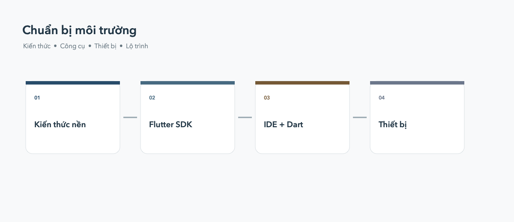

# Yêu cầu trước khi học Flutter

Bạn không cần biết mọi thứ trước khi bắt đầu. Chỉ cần chuẩn bị những điều cơ
bản dưới đây và học thêm trong quá trình thực hành.



## Kiến thức nền tảng

Nên biết biến, kiểu dữ liệu, hàm, điều kiện, vòng lặp và cách đọc thông báo
lỗi. Nếu chưa biết, bạn có thể học song song trong phần Dart cơ bản.

## Công cụ cần có

- Máy tính Windows, macOS hoặc Linux.
- Kết nối Internet.
- [↗ Flutter SDK](https://docs.flutter.dev/get-started/install).
- [↗ VS Code](https://code.visualstudio.com/) hoặc
  [↗ Android Studio](https://developer.android.com/studio).
- [↗ Extension Flutter](https://marketplace.visualstudio.com/items?itemName=Dart-Code.flutter)
  và [↗ Dart](https://marketplace.visualstudio.com/items?itemName=Dart-Code.dart-code).

Sau khi cài đặt, kiểm tra môi trường bằng lệnh:

```bash
flutter doctor -v
```

## Thiết bị chạy thử

Bạn có thể bắt đầu nhanh bằng Chrome. Sau đó, khi cần kiểm tra ứng dụng
mobile, hãy cài Android Emulator, iOS Simulator hoặc kết nối điện thoại thật.
Mỗi lựa chọn phù hợp với một nhu cầu khác nhau:

- **Android Emulator**: chạy được trên Windows, macOS và Linux. Cài
  [Android Studio](https://developer.android.com/studio), mở **Device
  Manager**, tạo một virtual device rồi khởi động emulator. Flutter cũng có
  thể liệt kê và khởi động emulator bằng:

  ```bash
  flutter emulators
  flutter emulators --launch <emulator-id>
  ```

  Xem hướng dẫn chính thức về
  [tạo và quản lý Android Virtual Device](https://developer.android.com/studio/run/managing-avds).

- **iOS Simulator**: chỉ có trên macOS. Cài
  [Xcode](https://developer.apple.com/xcode/), mở Xcode một lần để cài
  components cần thiết, sau đó mở Simulator từ menu **Xcode → Open Developer
  Tool → Simulator**. Xem thêm
  [tài liệu Flutter cho iOS setup](https://docs.flutter.dev/platform-integration/ios/setup).

- **Điện thoại Android thật**: bật **Developer options** và **USB debugging**,
  kết nối cáp USB, chấp nhận hộp thoại cấp quyền trên điện thoại rồi chạy
  `flutter devices`. Hướng dẫn chi tiết:
  [Run apps on a hardware device](https://developer.android.com/studio/run/device).

- **iPhone thật**: cần macOS + Xcode. Kết nối iPhone, chọn **Trust This
  Computer**, bật Developer Mode nếu Xcode yêu cầu và chọn Team trong phần
  Signing & Capabilities. Xem
  [chạy app trên thiết bị iOS thật](https://docs.flutter.dev/platform-integration/ios/setup#device).

Nếu chỉ mới học Flutter, Chrome là lựa chọn nhanh nhất. Khi làm giao diện
mobile, nên kiểm tra thêm ít nhất một Android Emulator hoặc điện thoại thật;
Simulator không thay thế hoàn toàn việc đo kích thước, hiệu năng và hành vi
touch trên thiết bị thật.

```bash
flutter devices
flutter run -d chrome
```

## Lộ trình đề xuất

1. Làm quen với Dart.
2. Học Widget và layout.
3. Tìm hiểu state và navigation.
4. Gọi API, lưu trữ dữ liệu và viết test.
5. Build và deploy ứng dụng.
