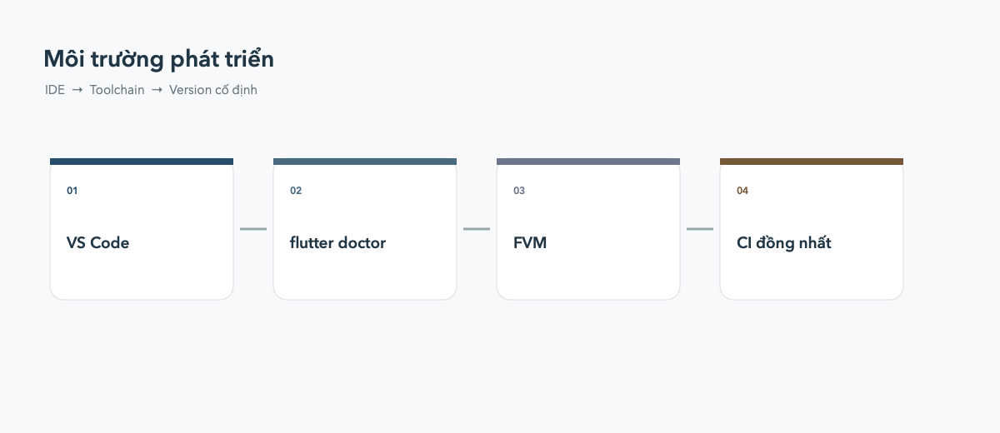

# Thiết lập môi trường phát triển Flutter

Một môi trường ổn định giúp phân biệt lỗi code với lỗi cài đặt. Hãy kiểm tra
toolchain trước khi tìm cách sửa một lỗi Dart hoặc Flutter.



## Chọn IDE

### VS Code

VS Code nhẹ, khởi động nhanh và phù hợp với đa số người mới. Cài
[↗ extension Flutter](https://marketplace.visualstudio.com/items?itemName=Dart-Code.flutter);
extension này sẽ cài kèm [↗ Dart](https://marketplace.visualstudio.com/items?itemName=Dart-Code.dart-code):

```bash
code --install-extension Dart-Code.flutter
```

Nên bật format code khi lưu:

```json
{
  "editor.formatOnSave": true
}
```

### Android Studio

[↗ Android Studio](https://developer.android.com/studio) nặng hơn nhưng tích hợp
Android SDK Manager và AVD Manager.
Chọn công cụ này nếu bạn thường xuyên cần tạo Android Emulator hoặc debug code
native Android.

Không cần cài cả hai IDE ngay từ đầu. Chọn một IDE chính, sau đó cài thêm công
cụ khi có nhu cầu.

## Kiểm tra bằng Flutter Doctor

Chạy lệnh này sau khi cài Flutter hoặc khi gặp lỗi môi trường:

```bash
flutter doctor -v
```

Kết quả thường kiểm tra Flutter SDK, Android toolchain, Xcode, Chrome và IDE.
Hãy xử lý các dòng có dấu `✗` trước; dòng `!` có thể là cảnh báo không ảnh
hưởng đến nền tảng bạn đang học.

Một số lệnh hữu ích khác:

```bash
flutter --version
flutter devices
flutter pub get
```

## Vì sao nên dùng FVM?

Nếu máy chỉ có một Flutter SDK trong `PATH`, việc nâng cấp để làm project mới
có thể làm project cũ không build được. FVM (Flutter Version Management) cho
phép mỗi project ghim một version Flutter riêng.

Ví dụ quy trình cơ bản:

```bash
dart pub global activate fvm
fvm install 3.29.0
fvm use 3.29.0
fvm flutter doctor
fvm flutter pub get
fvm flutter run
```

Khi dùng FVM, commit file cấu hình version của project vào git để mọi thành
viên và CI dùng cùng một SDK. Trong project đã dùng FVM, ưu tiên chạy
`fvm flutter ...` thay vì `flutter ...`.

## Lỗi môi trường thường gặp

- `flutter: command not found`: kiểm tra lại `PATH` và mở terminal mới.
- Không có device: chạy `flutter devices`, sau đó mở emulator hoặc bật USB
  debugging trên điện thoại.
- Android license chưa được chấp nhận: chạy `flutter doctor --android-licenses`.
- iOS không build được trên Windows/Linux: build iOS cần macOS và Xcode.
- Dependency lỗi sau khi đổi version: chạy `flutter clean`, rồi
  `flutter pub get` khi thật sự cần; không nên dùng `clean` theo thói quen.

## Checklist trước khi bắt đầu code

- `flutter doctor -v` không còn lỗi liên quan đến nền tảng bạn dùng.
- `flutter devices` hiển thị ít nhất một thiết bị.
- `flutter pub get` chạy thành công trong project.
- Project chạy được bằng `flutter run`.
- Version Flutter của project đã được ghi lại, dùng FVM nếu team có nhiều
  project hoặc CI yêu cầu version cố định.
