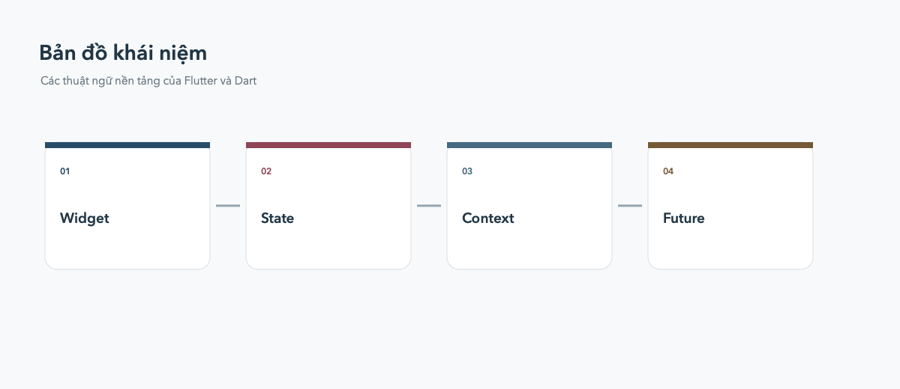

# Thuật ngữ Flutter và Dart

## Widget

Đơn vị cấu tạo giao diện Flutter. `Text`, `Container`, `Row`, `Column` và
`Scaffold` đều là widget. Widget thường được lồng vào nhau thành một cây.

## StatelessWidget và StatefulWidget

`StatelessWidget` không tự giữ state thay đổi trong vòng đời của nó.
`StatefulWidget` đi cùng một object `State`, dùng `setState` để yêu cầu Flutter
build lại phần giao diện phụ thuộc vào state.

## State

Dữ liệu thay đổi theo thời gian và ảnh hưởng đến giao diện, ví dụ trạng thái
checkbox, nội dung giỏ hàng hoặc tab đang chọn.

## BuildContext

Đối tượng đại diện cho vị trí của widget trong cây widget. Dùng context để
đọc `Theme`, `MediaQuery`, `Navigator` và các inherited widget khác.

## `pubspec.yaml`

File cấu hình project: tên, version, dependency, asset và font. Sau khi sửa
dependency hoặc asset, chạy `flutter pub get`.

## Package và plugin

Package là thư viện Dart/Flutter dùng lại được. Plugin là package có thêm code
native để truy cập khả năng của Android, iOS hoặc nền tảng khác.

## Hot Reload và Hot Restart

Hot Reload nạp code mới mà cố gắng giữ state hiện tại. Hot Restart chạy lại
ứng dụng từ đầu và xóa state trong memory.

## Null safety

Dart phân biệt kiểu có thể là `null` (`String?`) và kiểu không thể là `null`
(`String`). Dùng `!` để ép non-null chỉ khi chắc chắn giá trị không null.

## `Future`, `async` và `await`

`Future<T>` biểu diễn một kết quả sẽ có trong tương lai. Hàm `async` có thể dùng
`await` để chờ kết quả mà không khóa UI thread.

## Key

`Key` giúp Flutter nhận diện một widget giữa các lần build. Dùng key khi danh
sách có thể đổi thứ tự hoặc khi cần giữ state của item cụ thể.

## BuildContext và lifecycle

Không nên dùng `context` sau khi widget đã bị dispose. Với thao tác bất đồng
bộ, kiểm tra `context.mounted` trước khi gọi navigation hoặc hiển thị dialog.

## Debug, profile và release

Debug phục vụ phát triển, profile phục vụ đo hiệu năng, còn release là bản
phân phối cho người dùng. Không dùng hiệu năng của debug để kết luận app chạy
chậm trong production.
