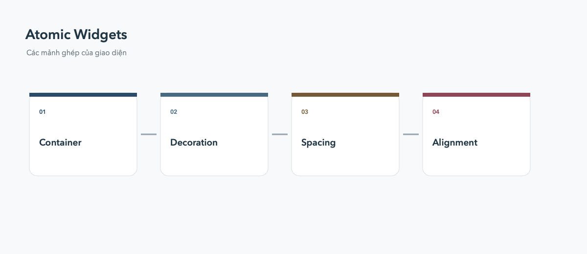

# Atomic Widgets

BoxDecoration, TextStyle, alignment, padding và margin là những mảnh ghép nhỏ để tạo nên giao diện rõ ràng.



## BoxDecoration

Dùng `BoxDecoration` cho màu nền, border, bo góc và shadow. `BoxShadow` nên dùng vừa phải để tạo thứ bậc thị giác.

```dart
Container(
  padding: const EdgeInsets.all(16),
  decoration: BoxDecoration(
    color: Colors.white,
    borderRadius: BorderRadius.circular(16),
    boxShadow: const [BoxShadow(blurRadius: 12, color: Colors.black12)],
  ),
)
```

## Khoảng cách và căn chỉnh

`Padding` nằm bên trong widget, `margin` thường được tạo bằng `Container` hoặc `Padding` ở parent. Dùng `MainAxisAlignment` theo trục chính và `CrossAxisAlignment` theo trục phụ.
