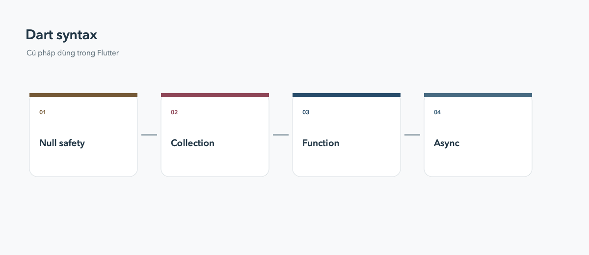

# Dart syntax

Null safety, collection, function và async là các phần xuất hiện mỗi ngày trong code Flutter.



## Null safety và collection

`String?` có thể null, còn `String` thì không. Dùng `??` cho giá trị dự phòng, `?.` cho truy cập an toàn, và spread `...` để ghép collection.

```dart
final label = user?.name ?? 'Khách';
final items = [header, ...results, if (showFooter) footer];
```

## Async và cascade

Dùng `async`/`await` cho `Future`, luôn xử lý loading và error. Cascade `..` hữu ích khi cấu hình cùng một object nhưng không nên lạm dụng làm code khó đọc.
