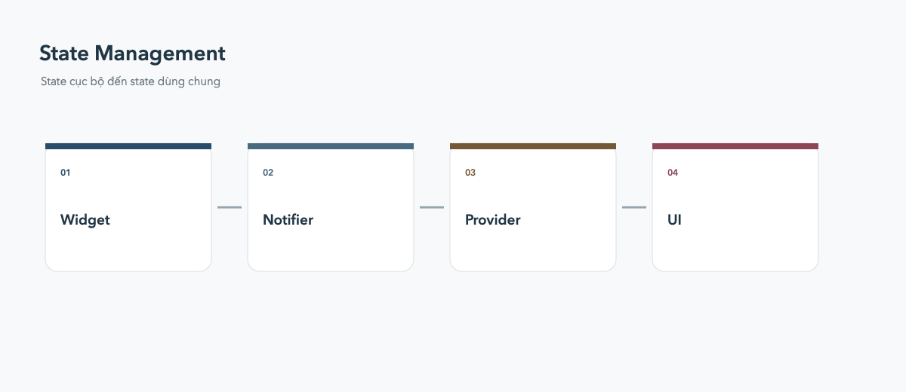

# State Management

State cục bộ nên ở gần widget sử dụng; state dùng chung cần một nguồn sự thật rõ ràng.

## Từ nhỏ đến lớn

- `setState`: state chỉ thuộc một màn hình hoặc component.
- `ValueNotifier`: state nhỏ, cần rebuild có mục tiêu.
- `ChangeNotifier` + Provider: ứng dụng vừa, API dễ tiếp cận.
- Riverpod hoặc BLoC: dependency/state phức tạp, cần test và tổ chức chặt.

## Nguyên tắc

Không đưa mọi thứ vào global state. Tách model, repository và UI; widget chỉ lắng nghe state và phát event.
