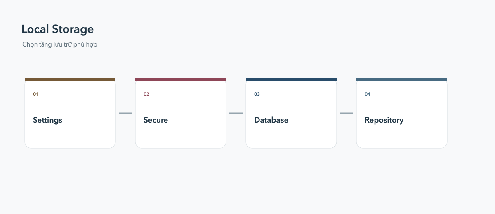

# Local Storage

Không phải dữ liệu nào cũng cần database. Xác định kích thước, cấu trúc và vòng đời trước khi chọn package.

## Lựa chọn

- `shared_preferences`: setting nhỏ dạng key-value, không dùng cho secret.
- Secure storage: token và dữ liệu nhạy cảm.
- SQLite/Drift: dữ liệu quan hệ, query và migration.
- Hive/Isar: object local cần tốc độ và API đơn giản.

Luôn bọc tầng lưu trữ sau repository, version hóa schema và xử lý trường hợp dữ liệu cũ hoặc hỏng.
