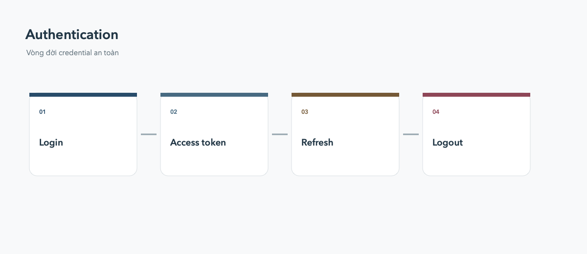

# Login & Credential

Authentication không chỉ là màn hình login: cần quản lý token, session, refresh và logout sạch.

## Token lifecycle

Access token nên có thời hạn ngắn; refresh token cần lưu trong secure storage. Khi API trả 401, refresh một lần rồi retry request, tránh vòng lặp vô hạn.

## Logout

Xóa credential local, reset user state, hủy request nhạy cảm và đưa người dùng về màn hình login. Không hardcode secret trong app và không commit file chứa credential.
