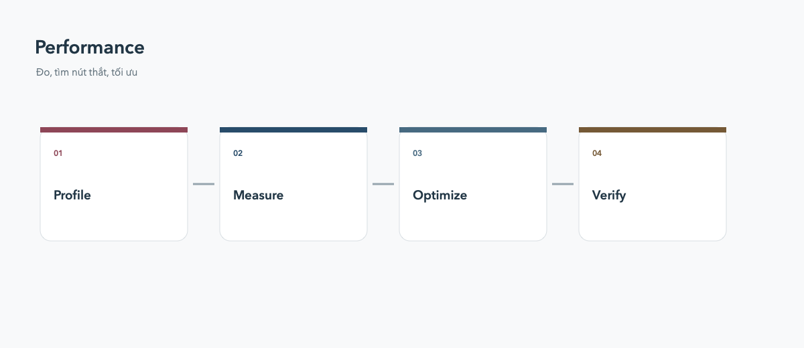

# Performance

Đo trước khi tối ưu: DevTools cho biết frame nào chậm và widget nào rebuild quá nhiều.

## Checklist

- Dùng `const` cho widget bất biến.
- Dùng builder cho list/grid dài.
- Tách widget để giới hạn vùng rebuild.
- Resize ảnh trước khi decode ảnh lớn.
- Tránh công việc nặng trong `build()`.

`RepaintBoundary` hữu ích cho vùng vẽ độc lập, nhưng không nên thêm mọi nơi. So sánh profile build trước và sau thay đổi.
