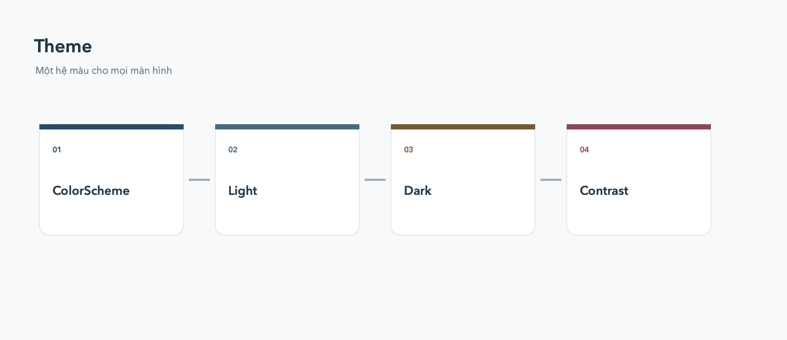

# Theme & Dark Mode

Theme tập trung màu sắc, typography và component defaults để màn hình mới không phải tự chọn style.

## ThemeData

Dùng `ColorScheme.fromSeed` để tạo palette và đọc màu qua `Theme.of(context).colorScheme`. Không hardcode màu trên từng widget nếu đó là màu thương hiệu hoặc trạng thái dùng chung.

## Dark mode

Khai báo `theme`, `darkTheme` và `themeMode`; lưu lựa chọn người dùng nếu cần. Kiểm tra contrast, divider, ảnh và icon ở cả hai mode.
