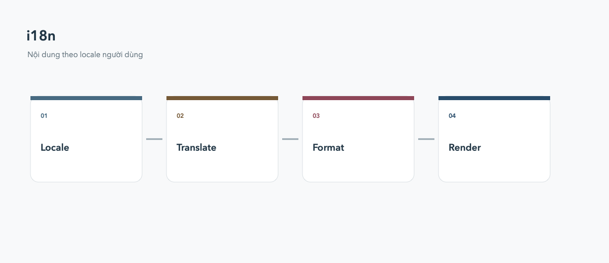

# Đa ngôn ngữ

Internationalization nên được thiết kế sớm để text, ngày tháng và số không bị hardcode.



## Locale

Khai báo `supportedLocales`, `localizationsDelegates` và locale mặc định. Dùng generated localization thay vì rải chuỗi dịch trong widget.

```dart
MaterialApp(
  supportedLocales: const [Locale('vi'), Locale('en')],
  locale: const Locale('vi'),
)
```

Format tiền, ngày và số bằng locale; đừng tự nối chuỗi theo giả định tiếng Việt.
