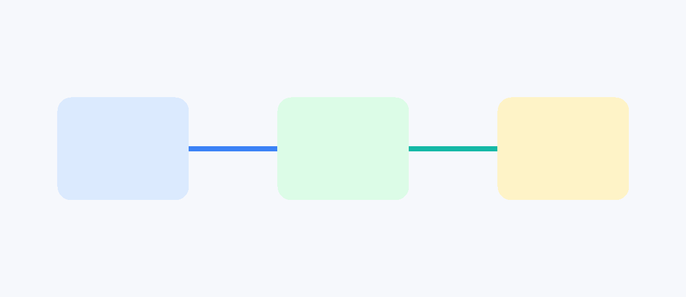

# Bắt đầu với Flutter

Bài này dành cho người chưa từng dùng Flutter. Mục tiêu không phải là hiểu
ngay mọi dòng code, mà là đi từ lúc chưa có project đến lúc nhìn thấy ứng dụng
đầu tiên chạy trên máy.



## Flutter và Dart là gì?

Dart là ngôn ngữ lập trình do Google phát triển. Flutter là framework dùng Dart
để xây dựng giao diện cho Android, iOS, Web, Windows và macOS từ một codebase.

Trong Flutter, mọi thứ nhìn thấy trên màn hình đều là một `Widget`: chữ, nút
bấm, khoảng cách, màu nền và cả bố cục của màn hình.

```dart
import 'package:flutter/material.dart';

void main() {
  runApp(
    const MaterialApp(
      home: Scaffold(
        body: Center(child: Text('Hello Flutter')),
      ),
    ),
  );
}
```

## Cài Flutter SDK

1. Tải Flutter SDK từ [flutter.dev](https://flutter.dev).
2. Giải nén SDK vào một thư mục không cần quyền administrator.
3. Thêm thư mục `flutter/bin` vào `PATH`.
4. Mở terminal mới rồi kiểm tra:

```bash
flutter --version
flutter doctor
```

Đọc từng dòng trong kết quả `flutter doctor`. Dòng có dấu `✗` hoặc `!` thường
cho biết còn thiếu Android SDK, Xcode, Chrome hoặc extension của IDE. Nếu chỉ
học Flutter Web, có thể bắt đầu với Chrome trước và cài toolchain mobile sau.

## Tạo project đầu tiên

Chạy các lệnh sau:

```bash
flutter create hello_flutter
cd hello_flutter
flutter run -d chrome
```

`flutter create` sinh ra một project hoàn chỉnh, trong đó `lib/main.dart` là
điểm bắt đầu của ứng dụng. Không cần hiểu hết code mẫu trước khi chạy thử.
Việc nhìn thấy app chạy giúp kiểm tra môi trường đã sẵn sàng.

## Những thư mục quan trọng

- `lib/`: code Dart của ứng dụng.
- `lib/main.dart`: entry point mặc định.
- `test/`: unit test và widget test.
- `pubspec.yaml`: tên project, dependency, asset và version.
- `android/`, `ios/`, `web/`: cấu hình riêng cho từng nền tảng.

Lúc mới học, phần lớn thời gian sẽ làm việc trong `lib/`. Chỉ chỉnh thư mục
`android/` hoặc `ios/` khi cần cấu hình nền tảng, permission hoặc build release.

## Chạy app và Hot Reload

Liệt kê các thiết bị Flutter nhận diện được:

```bash
flutter devices
```

Chạy app trên một thiết bị cụ thể:

```bash
flutter run -d chrome
flutter run -d <device-id>
```

Khi lệnh `flutter run` đang chạy:

- **Hot Reload (`r`)**: áp dụng code mới nhưng giữ state hiện tại.
- **Hot Restart (`R`)**: chạy lại app từ đầu và reset state.
- **Quit (`q`)**: dừng phiên chạy.

Hot Reload phù hợp khi sửa giao diện hoặc logic trong `build()`. Dùng Hot
Restart khi thay đổi khởi tạo state hoặc khi Hot Reload chưa phản ánh đúng.

## Bài tập nhỏ

Mở `lib/main.dart`, đổi nội dung `Text` thành tên của bạn, lưu file và quan sát
Hot Reload. Sau đó thử thay `Center` bằng `Column` và thêm một `Text` thứ hai.
