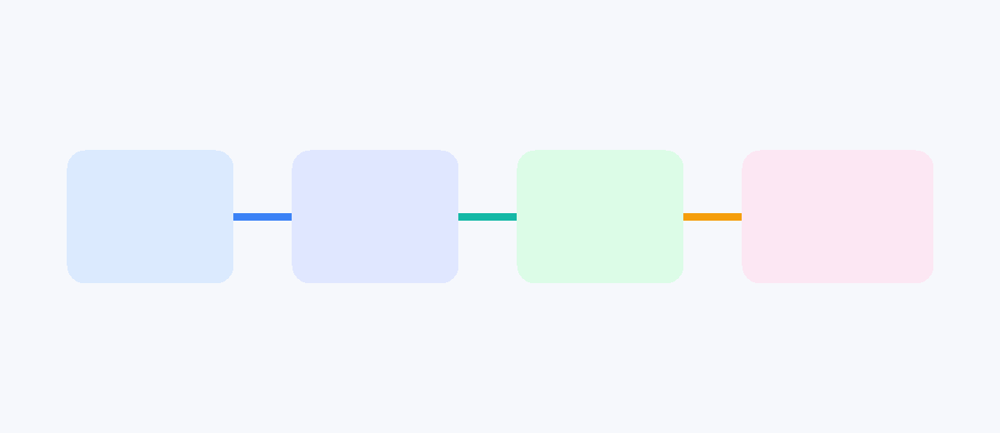

# API & Service

Tách HTTP client, model và repository để UI không biết chi tiết endpoint.



## Luồng chuẩn

1. Client gửi request với timeout và auth header.
2. Repository kiểm tra status code và parse JSON thành model.
3. UI hiển thị loading, success, empty và error.

```dart
try {
  final response = await client.get(uri);
  if (response.statusCode != 200) throw Exception('Request failed');
} catch (error) {
  // ghi log và hiển thị trạng thái lỗi phù hợp
}
```

Debounce ô tìm kiếm, cancel request cũ khi cần và không log token/PII.
